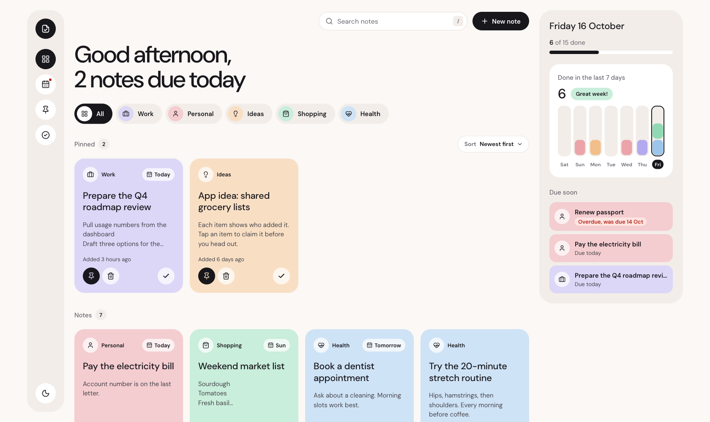

# Notes Dashboard

A React notes app for the Karbon Digital AI Engineering Assessment. Notes live
in a small FastAPI backend, and every create, read, update and delete goes
through its API. Beyond the brief, each note can have a category, a due date,
a pin and a done tick, so the dashboard works as a light to-do list too.



## Run it

You need **Python 3.11 or newer** and **Node 22** (built with Python 3.14 and
Node 22.22). Use two terminals, both starting at the repository root.

**Terminal 1: the API** on http://127.0.0.1:8000

```bash
python3 -m venv .venv
source .venv/bin/activate        # Windows: .venv\Scripts\activate
pip install -r backend/requirements.txt
uvicorn backend.main:app --port 8000 --reload
```

**Terminal 2: the app** on http://localhost:5173

```bash
cd frontend
npm install
npm run dev
```

Open http://localhost:5173. The backend starts with 15 sample notes dated
around today, so every view has something in it. Notes are kept in memory, so
restarting the backend resets them.

The Vite dev server forwards `/api/*` to port 8000, so the browser talks to a
single origin and the backend needs no CORS setup. To use an API somewhere
else, set `VITE_API_URL`.

Other ways to run it:

| Want to | Run |
| --- | --- |
| See the loading states (local answers are too fast to notice) | `NOTES_API_LATENCY_MS=800 uvicorn backend.main:app --port 8000` |
| Try the production build | `cd frontend && npm run build && npm run preview`, then open http://localhost:4173 |
| Run the frontend tests | `cd frontend && npm test` |
| Run the backend tests | `pytest backend/tests` (from the root, with the venv active) |
| Lint | `cd frontend && npm run lint` |

Keyboard: `N` new note, `/` search, `Esc` closes the editor or cancels a
delete. In the editor, `Enter` in the title saves, and `Ctrl+Enter` /
`Cmd+Enter` saves from the note text.

## Deploy

The live demo runs on Vercel as one project with two
[services](https://vercel.com/docs/services), set up in `vercel.json`:

- `frontend/` is built with Vite and served as static files.
- `backend/` runs the same FastAPI app as a Python function.
- Requests to `/api/*` go to the backend with `/api` removed, exactly as the
  Vite proxy does locally; everything else goes to the frontend. One domain
  serves both, so there is still no CORS setup.

To deploy your own copy: `npx vercel@latest deploy --prod` from the
repository root.

Notes are still kept in memory. The function sleeps when no one is using it,
and waking up starts it again with the 15 sample notes, so the demo resets
after a quiet spell. A real deployment would swap `NoteStore` for a database;
nothing outside `backend/main.py` would change.

## What the brief asked for, and where it lives

| Requirement | How it's met | Code |
| --- | --- | --- |
| Notes with `id`, `title`, `content` | The server assigns ids, so two clients can never pick the same one | `backend/main.py` |
| Card / grid layout | Edge-to-edge responsive grid: as many columns as fit, one on phones; a pastel card per category | `NotesDashboard.tsx`, `NoteCard.tsx` |
| Add, edit (modal), delete | Native `<dialog>` editor; delete asks inside the card first | `NoteFormDialog.tsx`, `NoteCard.tsx` |
| All CRUD through the API | `GET/POST/PUT/DELETE /notes`; the UI never edits notes without a request | `api/notes.ts`, `notes/useNotes.ts` |
| Hooks only | Function components and hooks throughout, no classes | `frontend/src` |
| Context or a state library | TanStack Query for server state; React Context for toasts | `useNotes.ts`, `toast/` |
| Loading and error handling | Loading screen, readable error with "Try again", failed saves explained in a toast with "Try again" | `NotesStates.tsx`, `api/client.ts`, `useNotes.ts` |
| CSS Modules, Tailwind or styled-components | CSS Modules plus a small token file | `styles/tokens.css`, `*.module.css` |

## Stretch features

- **Search and filters.** Search covers titles and note text, ignoring case
  and extra spaces. Filter by category, switch views (All, Today, Pinned,
  Done) and sort (newest, due date, A to Z) from a custom dropdown that
  works like a native one with mouse, keyboard and screen readers. Search,
  sort, New note and the filters stay pinned to the top while you scroll.
- **Optimistic UI.** New, edited, ticked and deleted notes change on screen at
  once. If the server refuses, the change rolls back and a toast says what
  failed, with "Try again". A just-ticked note offers "Undo". Offline, a
  save fails at once with "You're offline" instead of waiting silently.
- **Tests.** 31 frontend tests with React Testing Library cover the card, the
  sort dropdown, the whole app against a fake server, and the pure logic. 16 backend tests cover
  the API. See [Tests](#tests).
- **React Native.** A short plan is below in
  [Adapting it to mobile](#adapting-it-to-mobile).

Added on top of the brief:

- Categories, due dates (overdue and due-today states), pin to top, mark done
  and undo, with the server keeping the time a note was finished.
- A side panel with today's progress, a chart of the last 7 days and the notes
  due soon. It folds into a slim strip (date, progress ring, due count), and
  the left rail widens to show names; both remember your choice.
- A scroll map beside the notes: every card drawn as a small block in its
  category's colour (outlined when done), with a lens over what's on screen.
  Hover a block to see the note's title, click it to jump there (the card
  flashes a ring), or drag to scrub through the list.
- Motion that answers what you do: cards lift on hover, buttons press and
  spring back, toasts and the editor fade out instead of vanishing, and the
  theme spreads out in a circle from its button. All of it calms down under
  "reduce motion".
- Light and dark themes (following the system until you choose), keyboard
  shortcuts, and a layout that works from a 320px phone to a wide desktop.
- The look comes from a written design system: [docs/design-system.md](docs/design-system.md).

## Libraries and decisions

| Choice | Why |
| --- | --- |
| **Vite + React 19 + TypeScript (strict)** | Fast dev server, and types shared from one `Note` definition in `api/notes.ts` |
| **TanStack Query** for server state | The notes belong to the server, not the browser. Query handles caching, refetch when the window regains focus, loading and error state, and optimistic updates with rollback, which a hand-rolled Context store would have to reimplement |
| **React Context** for toasts | Toasts are client-only state that any component can raise; nothing else needed a global store |
| **CSS Modules + design tokens** | Scoped class names, no runtime cost, and every colour is a token, so dark mode is one token swap |
| **Native `<dialog>`** for the editor | The browser handles focus trapping, `Esc` and the backdrop |
| **lucide-react** icons, **DM Sans** font (self-hosted) | Small, consistent icon set; no request to a font CDN |
| **Vitest** instead of Jest | The project is built with Vite, so Vitest reuses its config with no Babel setup. It runs Jest's API (`describe`, `it`, `expect`, `vi.fn` for `jest.fn`) with the same React Testing Library |
| **oxlint** | A fast linter, so it runs on every change |

Changes to the FastAPI starter:

- **The server assigns ids.** Clients send only the note's fields.
- **Missing notes return 404.** The starter answered 200 with an error body,
  so the frontend could not tell failure from success.
- **Writes take a lock.** FastAPI runs sync endpoints on a thread pool, so
  two requests could touch the list at the same time.
- **Validation.** Titles must not be blank; titles are capped at 200
  characters and notes at 10,000; categories come from a fixed list.

## Built to handle many notes, and long ones

Measured with 2,015 notes on the development laptop:

| What | Result |
| --- | --- |
| `GET /notes`, 2,015 notes, plain JSON | 5.15 MB in 26 ms |
| The same, gzipped | 0.14 MB in 37 ms |
| The same, unchanged since the last fetch | 304 (empty body) in 2 ms |
| Typing in search, CPU slowed 4x | 40 to 128 ms per keystroke |
| Ticking a note done, CPU slowed 4x | 60 to 129 ms |
| Laying out 192 cards again, CPU slowed 4x | 53 ms before, 8 ms after `content-visibility` |
| Production bundle | 93 kB JS and 6 kB CSS, gzipped |
| Production first load | Largest paint 266 ms, layout shift 0 |

How:

- **Backend.** Notes are stored by id, so finding, editing and deleting one
  costs the same with ten notes or ten thousand. The list is turned into JSON
  once per change, not once per request, and carries an ETag: the app
  refetches whenever the window regains focus, and when nothing changed the
  answer is an empty 304. Large answers are gzipped. Request bodies over
  128 KB are refused before they are read.
- **Rendering.** Each section draws 48 cards, then a "Show 48 more" button
  (focus moves to the first new card). Cards are memoised, so ticking one
  note re-renders one card, not the grid. Cards far off screen skip layout
  and paint (`content-visibility: auto`).
- **Search.** Typing stays responsive because filtering runs at a lower
  priority than the keystroke (`useDeferredValue`), and each note's search
  text is computed once and cached per note.
- **Long text.** A card shows up to three title lines and a 280-character
  preview, cut without splitting an emoji. The editor grows to fit, shows how
  many characters are left as a field nears its limit, and uses the same
  limits as the server, so a save never fails on length.

## Tests

```bash
cd frontend && npm test            # 31 tests, about 5 seconds
pytest backend/tests               # 16 tests, under 1 second
```

| File | Covers |
| --- | --- |
| `NoteCard.test.tsx` | The component test the brief asks for: title and preview, overdue wording, pin / done / open, and the delete confirmation (focus starts on "Keep", so pressing Enter twice can't delete) |
| `Select.test.tsx` | The sort dropdown: pick with the mouse, then with the keyboard alone, Escape closes without changing anything, typing a letter jumps to an option, a press outside closes it |
| `App.test.tsx` | The whole app against a fake server: loading, a failed load with "Try again", a new note shown before the server answers, search with no matches, done and Undo, a failed delete that rolls back and then succeeds on "Try again", an offline save that fails at once and keeps focus in the page |
| `selectNotes.test.ts`, `dates.test.ts`, `text.test.ts` | Sections, search, filters and sorting; date maths across month and year ends; preview cutting with emoji |
| `backend/tests/test_api.py` | Ids, defaults, validation and limits, 304s, gzip, 404s, done time kept on edit and cleared on undo |

## Adapting it to mobile

Most of the app is already free of the DOM and would carry over unchanged:
the API client, the TanStack Query hooks with their optimistic updates, and
the pure logic (`selectNotes`, `dates`, `text`). In a monorepo, that becomes a
shared package used by both the web app and an Expo app.

What changes:

- **Components.** `div`/`button` become `View`/`Pressable`/`Text`. The card
  grid becomes a `FlatList` with `numColumns` (or FlashList). Lists that
  virtualise make the 48-card paging and `content-visibility` unnecessary.
- **Editor.** The `<dialog>` becomes a modal screen or bottom sheet, wrapped
  in `KeyboardAvoidingView` so the keyboard never covers the note.
- **Styling.** The CSS tokens become a theme object read through
  `StyleSheet`. `useColorScheme` replaces the media query, and AsyncStorage
  replaces `localStorage` for the theme choice.
- **Phone gestures.** Swipe a card to mark it done or delete it, with haptic
  feedback. Keyboard shortcuts go away.
- **Network.** TanStack Query's `focusManager` listens to `AppState`, so the
  app refetches when it comes back to the foreground. `onlineManager` uses
  NetInfo. A persisted query cache lets notes open offline.
- **Accessibility.** `aria-label` becomes `accessibilityLabel`, and live
  regions become `AccessibilityInfo.announceForAccessibility`.
- **API address.** There is no Vite proxy, so the base URL comes from config
  (`10.0.2.2:8000` reaches the host from the Android emulator).

## Project layout

```
backend/
  main.py              API, storage, validation, ETag and gzip
  tests/test_api.py
frontend/src/
  api/                 fetch wrapper with readable errors, typed notes API
  notes/               dashboard, card, editor, scroll map, data hooks, pure logic
  panel/               progress panel (folds to a strip) and week chart
  layout/              icon rail (widens to show names) / bottom tab bar
  ui/                  the custom sort dropdown
  toast/               toasts (React Context)
  theme/, hooks/       theme, shortcuts, clock, stable callbacks
  styles/              design tokens and global styles
docs/design-system.md  colours, type, components, layout rules
```
